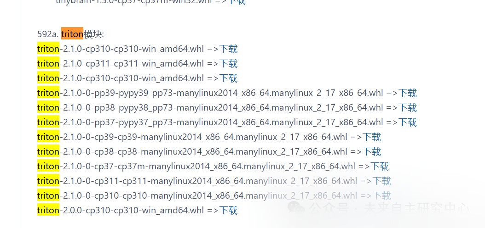

# [python] Windows: Install Triton module via whl file

In the Windows system, installing Triton via `.whl` files is a relatively straightforward process. Here's a detailed step-by-step guide:

1. Confirming the system environment

1.

Python version: Ensure that Python is installed and compatible with the Triton `.whl` file to be installed. For example, if you are downloading `triton-2.0.0-cp310-cp310-win-amd64.whl`, then you need Python 3.10 version.

1.

Operating System: Confirm that it is a 64-bit Windows operating system.

1.

pip tool: Ensure pip is installed, which is the package manager for Python, used to install external libraries.

#### 2. Download the Triton `.whl` file

1.

Visit reliable sources to download the Triton `.whl` files that are compatible with your Python version and operating system. Typically, you can download them from the official GitHub repository of Triton, HuggingFace mirrors, or other trusted third-party sources, such as gitee.com/FIRC/pythonlibs_whl_mirror.



1.

Download the `.whl` file to a specific location on your local computer, such as the Downloads folder.

#### 3. Install Triton

1.

Open Command Prompt (CMD) or PowerShell.

1.

Navigate to the directory where the `.whl` file is located. For example, if the file is located in the Downloads folder, use the command `cd %USERPROFILE%\Downloads` (PowerShell) or `cd ~/Downloads` (CMD, assuming the path contains the user's folder and is in English).

1.

Install the `.whl` file using pip. The command format is as follows:

```
pip install triton-x.x.x-cpXX-cpXX-win_amd64.whl

-

1

```

Please replace `triton-x.x.x-cpXX-cpXX-win_amd64.whl` with the actual downloaded file name. For example, if the downloaded file is `triton-2.0.0-cp310-cp310-win-amd64.whl`, the command would be:

```
pip install triton-2.0.0-cp310-cp310-win-amd64.whl

-

1

```

1.

Wait for the installation to complete. If you encounter permission issues, you can try running the command prompt as an administrator.

#### 4. Verification Installation

1.

Open the Python interactive interpreter or create a new Python script to test if Triton is installed successfully.

1.

Input the following code and run it:

```
import triton
print(triton.__version__)

-

1

-

2

```

If the installation is successful, this will output the version of Triton you installed.

#### 5. Use Triton

1.

You can try using some basic functions to verify if the installation is successful. For example, create a simple Triton program and use Triton's JIT compilation feature to accelerate computation.

1.

Refer to Triton's official documentation for more advanced configurations and usage methods.

#### VI. Addressing Potential Issues

1.

Version mismatch: Ensure that the downloaded `.whl` file matches your Python version and operating system.

1.

Dependencies: Triton may depend on other libraries (such as torch and numpy). Ensure these libraries are installed, and check if the environment variables are set correctly.

1.

Virtual environment: If you are working in a virtual environment, ensure that the correct virtual environment is activated and Triton is installed within this environment.

Following the above steps, you should be able to successfully install Triton on a Windows system via the `.whl` file and begin utilizing it for efficient and flexible deployment of deep learning model services.


## Payment

Here is a pay link on Stripe ( https://buy.stripe.com/3cs8yP7sY87d0vu9AB ). Please contact me lonlonago@foxmail.com after funding $89, and I will send you a complete data files , thank you!


